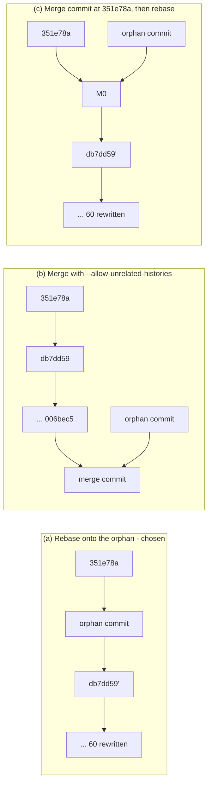
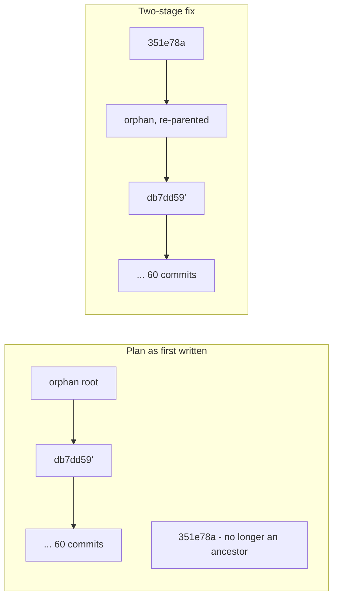
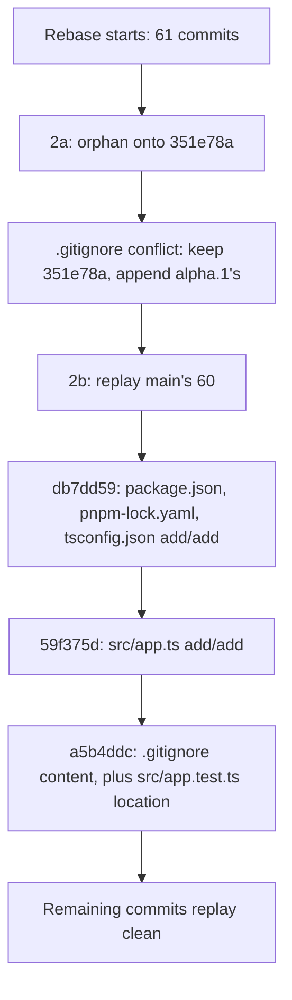
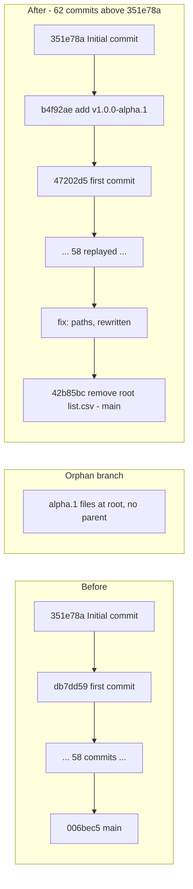
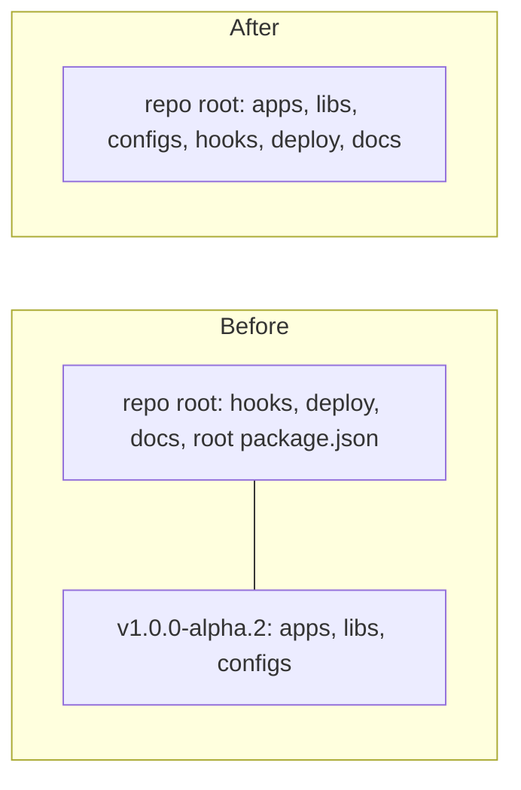

# Git surgery dump

Raw material, not edited prose. Nothing here is pushed. The credential files (`credentials.json`, `token.json`, `client.json`) were moved with `mv` and never read. Hashes, repo and domain names are real, so strip whatever should not be public.

## 0. The ask
- Copy `v1.0.0-alpha.1` (tracked files only, at the root of a new orphan branch). It had to be a copy, with nothing changed, reset or reverted.
- Insert that orphan directly after the repo's very first commit, `351e78a` ("Initial commit"). This rewrites the history of everything above it.
- Then, as a separate follow-up: flatten `v1.0.0-alpha.2/` up one level into the repo root.

## 1. Starting state
- Branch `main` at `006bec5`, clean tree. `origin/main` at `eb76ab6`.
- 61 commits total, so 60 above `351e78a`, including 1 real merge (`4ec1be5`, the `feat/v1-newssifter` merge). Earlier PRs were squash merges.
- `351e78a` has only 3 files (`.gitignore`, `LICENSE`, `README.md`). Its only child is `db7dd59`.
- The repo has 3 root commits overall, because other branches have unrelated histories.
- `v1.0.0-alpha.1` had 7 tracked files, plus ignored `node_modules/`, `dist/` and `.DS_Store`.
- alpha.1 had itself been created by a rename from `oldfakenewschecker/` (commit `330a16f`) on a side branch.
- Commits touching the root paths that would clash: `.gitignore` 5, `package.json` 11, `pnpm-lock.yaml` 9, `tsconfig.json` 3, `src/app.ts` 2.

## 2. Three ways to do "after 351e78a"


- **(a)** gives a linear history, and the orphan really does sit after `351e78a`. It rewrites 60 commits.
- **(b)** doesn't rewrite anything, but the orphan joins at the tip, not after `351e78a`.
- **(c)** makes the orphan a second parent, but it still rewrites the 60 commits.

## 3. Safety net and the orphan branch

```sh
git branch backup/main-pre-rewrite 006bec5
```
The orphan commit is built with plumbing, so the working tree, index and `main` aren't touched. The tree of the subdirectory becomes the root tree of a parentless commit:
```sh
sha=$(git commit-tree main:v1.0.0-alpha.1 -m "chore: add v1.0.0-alpha.1")
git branch orphan/alpha.1 "$sha"
```
- `main:v1.0.0-alpha.1` is a tree-ish. `commit-tree` takes a tree and no parents, so the result is a root commit with the alpha.1 files at the top level.
- Only tracked files can be in a tree, so the ignored files were left out automatically.

## 4. The mistake in the first plan
The first plan was `git rebase --rebase-merges --onto orphan/alpha.1 351e78a main`. That would have replayed the 60 commits onto the orphan root, which is a separate root. `351e78a` would have dropped out of the ancestry. It was caught before anyone ran it.


The fix is two stages:
```sh
# 2a: re-parent a COPY of the orphan onto 351e78a (orphan/alpha.1 stays pure)
git switch -c rewrite/alpha1 orphan/alpha.1
git rebase --onto 351e78a --root

# 2b: replay main's 60 commits onto that
git switch -c rewrite/main main
git rebase --rebase-merges --onto rewrite/alpha1 351e78a
```
`--root` lets you rebase a root commit. `--rebase-merges` keeps the real merge commit instead of flattening it.

## 5. Conflict log
Every conflict was an add/add, because alpha.1's files sit at the repo root and the old commits also added files at the root.



| Commit | Conflict | Resolution |
|---|---|---|
| orphan onto `351e78a` | `.gitignore` add/add | keep `351e78a`'s file, append alpha.1's two lines |
| `db7dd59` | `package.json`, `pnpm-lock.yaml`, `tsconfig.json` add/add | take `db7dd59`'s side of all three |
| `59f375d` | `src/app.ts` add/add | take `59f375d`'s side |
| `a5b4ddc` | `.gitignore` content | keep both sides |
| `a5b4ddc` | `src/app.test.ts` file location | `git rm` it |

Commands used:
```sh
# .gitignore at the orphan stage
git show 351e78a:.gitignore > .gitignore
git show orphan/alpha.1:.gitignore >> .gitignore
git add .gitignore
GIT_EDITOR=true git rebase --continue

# db7dd59 and 59f375d
git checkout --theirs -- package.json pnpm-lock.yaml tsconfig.json
git checkout --theirs -- src/app.ts

# a5b4ddc, .gitignore, keeping both sides
sed -i '' '/^<<<<<<< /d;/^=======$/d;/^>>>>>>> /d' .gitignore
git rm -f apps/api/src/app.test.ts
```

**Why "theirs" for the root-file conflicts.** The two sides were unrelated apps, and all later commits are diffs against the old content. Taking `db7dd59`'s content keeps the later diffs applying cleanly, and alpha.1's versions stay in history in the orphan commit.

**Rename detection can bite.** In `a5b4ddc`, `src/` was renamed to `apps/api/src/`. Git saw alpha.1's `src/app.test.ts` inside the renamed directory and tried to move it to `apps/api/src/app.test.ts`. That file never existed on the original `main`, so it was removed.

**`--theirs` flips in a rebase.** During a rebase, `--ours` is the branch you're building on (the rewritten base), and `--theirs` is the commit being replayed.

## 6. Verification before moving anything
```sh
git rev-list --max-parents=0 rewrite/main      # only 351e78a
git log --oneline 351e78a..rewrite/main | wc -l   # 61
git log --merges --oneline rewrite/main        # the one real merge survived
git diff --stat main rewrite/main
```
Results:
- `351e78a` is the only root, and there were 61 commits above it.
- The new order after `351e78a`: `b4f92ae` (the orphan commit), `47202d5` (`first commit`), `86256ea` (`Feature/app setup`).
- Differences against the old `main`:
  - `.gitignore`: +2 lines. This is the intended append.
  - `list.csv`: +921 lines at the repo root, a stray file. alpha.1's `list.csv` came in with the orphan commit and no later commit deletes it.
- Fix: a new commit at the tip, `git rm list.csv` then commit `chore: remove root list.csv`. After that the diff against old `main` was only the 2 `.gitignore` lines.
- Tests were green on the rewritten tree.

## 7. Moving `main`
```sh
git branch -f main rewrite/main
```
- `main` is now at `42b85bc`, with 62 commits above `351e78a`: the orphan commit, the 60 replayed commits, and the `list.csv` removal.
- The old tip is still reachable at `backup/main-pre-rewrite` (`006bec5`).
- `origin/main` is still `eb76ab6`. It has diverged, with 7 commits only on origin and 62 only on local `main`, so a push would need a force-push. Not pushed.
- Other branches still sit on the old history and would need rebasing: `ci-16/deploy-to-gcp`, `feat-7/harden-api`, `feat-18/add-tailwind`, `feat-11-6/working-poc`, `feat/nx-monorepo-setup`, `feat/v1-newssifter`.



## 8. Follow-up: flatten `v1.0.0-alpha.2/` into the repo root
Collisions at the root, where files existed in both places:
- `.eslintrc.json`
- `package.json`
- `pnpm-lock.yaml`

The root versions were a stray install, so alpha.2's versions won.


Commands:
```sh
git rm package.json pnpm-lock.yaml .eslintrc.json   # the root collisions

# installs and caches inside alpha.2 first
find v1.0.0-alpha.2 -name node_modules -type d -prune -exec rm -rf {} +
rm -rf v1.0.0-alpha.2/.nx
find v1.0.0-alpha.2 -name .DS_Store -delete

# tracked files and directories
cd v1.0.0-alpha.2
for f in <each top-level tracked file> apps libs; do git mv "$f" "../$f"; done
cd ..

# untracked or ignored files, git mv can't see these
mv v1.0.0-alpha.2/nx.json v1.0.0-alpha.2/client.json v1.0.0-alpha.2/credentials.json \
   v1.0.0-alpha.2/token.json v1.0.0-alpha.2/dump.rdb v1.0.0-alpha.2/dist .
```
What was learned:
- **`git mv` on a directory carries the ignored contents too.** Nested `node_modules` would have moved with `apps/` and `libs/`, and pnpm's symlinks break when moved. Delete them first and reinstall.
- **Ignored files need a plain `mv`.** `nx.json` and the credential files are gitignored by name, and the root `.gitignore` still ignores them at the new location.
- **Collisions show up as `M` plus `D`, not as renames.** Git can't pair a rename when the destination already exists. The three root files were compared against the old alpha.2 versions, and all three were identical.
- **`nx.json` was never tracked on `main`.** The pre-push hook only worked on this machine, and a fresh clone would fail it. It was flagged and left alone.

What broke after the flatten, and the fix for each:

| Thing | Why it broke | Fix |
|---|---|---|
| `prepare` script `cd .. && husky install` | climbs out of the repo | `husky install` |
| `.husky/pre-commit`, `commit-msg`, `pre-push` | looped over `*/…` configs, which find nothing at the root | run from the repo root; `pre-commit` and `pre-push` fail if the binary is missing |
| `deploy/deploy.sh` | required a `v<version>/` directory and a `--version` flag | workspace is the repo root; version read from `package.json`; flag removed |
| `deploy/README.md` | documented `--version` and `v<version>/` | updated |

Also added `scripts/bump-version.sh`, ported from another repo and extended for pre-releases:

| Command | `1.0.0-alpha.2` becomes |
|---|---|
| `major` | `2.0.0` |
| `minor` | `1.1.0` |
| `patch` | `1.0.1` |
| `prerelease` | `1.0.0-alpha.3` |

It also keeps a `.version-state` rollback history of the last 5 versions. Only `--dry-run` was run. A real bump wasn't, and the script's `package.json` write wasn't exercised. After `pnpm install`, everything was reported green.

## 9. Lessons (raw)
- Make a backup branch before any history rewrite. It's one command.
- `git commit-tree <tree-ish>` builds a root commit from any subdirectory without touching the working tree or index.
- `--onto <newbase> <upstream>` replays only commits after `<upstream>`, and a separate root isn't automatically connected to anything. The first plan was wrong here, and it was caught by thinking through the ancestry before running it.
- `--root` and `--rebase-merges` are the two flags that made this possible.
- Add/add conflicts between unrelated files: pick the side that later commits depend on.
- `--ours` and `--theirs` swap meaning in a rebase.
- Rename detection can move files you didn't expect.
- Review the result before moving the branch: roots, commit count, merges, and a diff against the old tip.
- Moving a directory moves its ignored contents. Hooks that glob for configs break silently when the layout changes.

## 10. Workflow note
Claude Code never ran a commit command. The CLAUDE.md forbids it and a hook enforces that, so every commit-creating step (the orphan commit, the rebases, the `list.csv` removal) was run by hand. Each diff was proposed and approved one file at a time before it was applied. Nothing was pushed, and `origin` was not touched.

## Not done or not verified
- `v1.0.0-alpha.1` is not removed yet, and `rmdir v1.0.0-alpha.2` is pending.
- A real bump and the deploy dry run from the new root were not exercised.
- Nothing is pushed.
- The other branches are not rebased.
